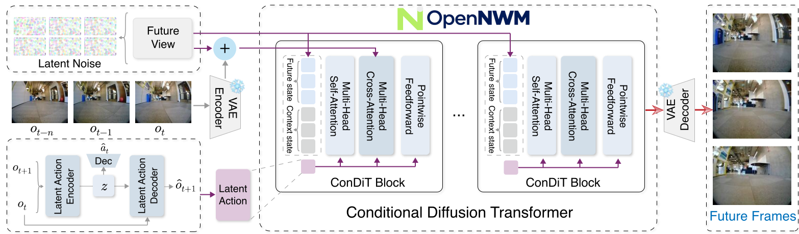

<div align="center">

<h1>OpenNWM</h1>
<h3>A Generalist Navigation World Model<br>with Latent Action Pretraining</h3>

<p><a href="https://github.com/OpenSpace-Lab"><strong>OpenSpace Lab</strong></a></p>
<p><em>Learn navigation dynamics from action-free video. Adapt them to physical world.</em></p>

<p>
  <a href="https://openspace-lab.github.io/OpenNWM/"></a>
  <a href="https://arxiv.org/abs/2611.01844"></a>
  <a href="https://huggingface.co/LittleB0sS/OpenNWM"></a>
  <a href="https://modelscope.cn/models/LittleBoss/OpenNWM"></a>
  <a href="https://huggingface.co/datasets/LittleB0sS/NavAnywhere"></a>
  <a href="https://modelscope.cn/datasets/LittleBoss/NavAnywhere"></a>
</p>

<a href="website/assets/paper/method-overview-20261031.pdf">
  <picture>
    <source media="(prefers-color-scheme: dark)" srcset="website/assets/paper/method-overview-dark-20261031.svg">
    
  </picture>
</a>

<p><a href="#news">News</a> · <a href="#environment-setup">Setup</a> · <a href="#data-preparation">Data</a> · <a href="#pretrained-models">Models</a> · <a href="#evaluation">Evaluation</a> · <a href="#training">Training</a> · <a href="#todo-list">TODO List</a></p>
</div>

## News

- **2026-11-03** — The paper is available on [arXiv](https://arxiv.org/abs/2611.01844).
- **2026-11-01** — Updated the paper figure and documentation. Code, models, and NavAnywhere data are available.

## Environment Setup

Requires Linux, Conda, and an NVIDIA GPU compatible with CUDA 12.4. Run from the repository root; LAM and NWM use separate environments.

```bash
git clone https://github.com/OpenSpace-Lab/OpenNWM.git
cd OpenNWM
for module in lam nwm; do
  conda create -n "open-$module" python=3.10 -y
  conda run -n "open-$module" python -m pip install torch==2.6.0 torchvision==0.21.0 \
    --index-url https://download.pytorch.org/whl/cu124
  conda run -n "open-$module" python -m pip install -r "$module/requirements.txt"
done

conda run -n open-nwm python setup_paths.py \
  --data-root /data/navigation --work-root /data/opennwm --nav-profile 15 \
  --lam-python "$(conda run -n open-lam python -c 'import sys; print(sys.executable)')" \
  --nwm-python "$(conda run -n open-nwm python -c 'import sys; print(sys.executable)')"
source .env
```

Replace `/data/navigation` and `/data/opennwm` with your data and work directories. Run `source .env` in each new terminal. To reuse existing splits, add `--split-root /path/to/splits` to `setup_paths.py`.

## Data Preparation

Download NavAnywhere from [Hugging Face](https://huggingface.co/datasets/LittleB0sS/NavAnywhere) or [ModelScope](https://modelscope.cn/datasets/LittleBoss/NavAnywhere) and extract it to `$NWM_DATA_ROOT`. The archives total **1.93 TB**; extraction requires `tar`, `zstd`, and additional disk space.

<details>
<summary>Download and extract with ModelScope</summary>

```bash
"$NWM_PYTHON" -m pip install modelscope
conda run -n open-nwm ms-hub download LittleBoss/NavAnywhere --repo-type dataset \
  --local-dir "$OPENNWM_WORK_ROOT/downloads/NavAnywhere" --max-workers 8
(
  cd "$OPENNWM_WORK_ROOT/downloads/NavAnywhere" || exit 1
  mkdir -p "$NWM_DATA_ROOT"
  find NavAnywhere -path '*/packs/*.tar.zst' -print0 \
    | xargs -0 -r -I{} tar --use-compress-program=unzstd -xf '{}' -C "$NWM_DATA_ROOT"
  for first in LAM-Data-{recon,scand,sacson}-*.tar.zst.part-00000; do
    [ -f "$first" ] || continue
    cat "${first%.part-00000}.part-"* \
      | tar --use-compress-program=unzstd -xf - -C "$NWM_DATA_ROOT"
  done
)
```

The action-data archives retain their `LAM-Data-` filenames. Expected layout:

```text
$NWM_DATA_ROOT/
├── recon/<trajectory>/{0.jpg,1.jpg,...,traj_data.pkl}
├── sacson/<trajectory>/{0.jpg,1.jpg,...,traj_data.pkl}
├── scand/<trajectory>/{0.jpg,1.jpg,...,traj_data.pkl}
├── tartan/<trajectory>/{0.jpg,1.jpg,...,traj_data.pkl}
└── NavAnywhere/<source>/<trajectory>/{0.jpg,1.jpg,...}
```

</details>

The release includes RECON, HuRoN (`sacson`), SCAND, and NavAnywhere. **TartanDrive requires a separate download** for world model post-training and default LAM evaluation; follow the [NWM data instructions](https://github.com/facebookresearch/nwm#data) and place it in `tartan/` (split name: `tartan_drive`). `setup_paths.py` prepares the fixed train/validation/test lists and NavAnywhere recipe.

## Pretrained Models

Download from [Hugging Face](https://huggingface.co/LittleB0sS/OpenNWM) or [ModelScope](https://modelscope.cn/models/LittleBoss/OpenNWM) into `$OPENNWM_WORK_ROOT/models/OpenNWM`, including `configs/`.

| Checkpoint | Use |
| :--- | :--- |
| `lam-nav15-pixel-action-step60k.ckpt` | Latent action extraction |
| `opennwm-nav15-stage1-pretrain60k.pth.tar` | World model pretraining checkpoint |
| `opennwm-nav15-stage2-joint100k.pth.tar` | Physical-action prediction and planning |

<details>
<summary>Download and verify with ModelScope</summary>

```bash
"$NWM_PYTHON" -m pip install modelscope
conda run -n open-nwm ms-hub download LittleBoss/OpenNWM --repo-type model \
  --local-dir "$OPENNWM_WORK_ROOT/models/OpenNWM" --max-workers 4
(cd "$OPENNWM_WORK_ROOT/models/OpenNWM" && sha256sum -c SHA256SUMS)
```

</details>

NWM downloads [SD-VAE](https://huggingface.co/stabilityai/sd-vae-ft-ema) on first use; set `NWM_VAE_PATH` in `.env` to use a local copy. DINOv3 is needed only for LAM variant 3.

## Evaluation

After preparing test data, import the Stage 2 checkpoint and run prediction:

```bash
"$NWM_PYTHON" run.py nwm import-checkpoint \
  --checkpoint "$OPENNWM_WORK_ROOT/models/OpenNWM/opennwm-nav15-stage2-joint100k.pth.tar" \
  --config "$OPENNWM_WORK_ROOT/models/OpenNWM/configs/opennwm-nav15-stage2.yaml" \
  --run-dir "$OPENNWM_WORK_ROOT/runs/released-stage2"
"$NWM_PYTHON" run.py nwm infer \
  exp_dir="$OPENNWM_WORK_ROOT/runs/released-stage2" ckp=latest eval_type=time \
  prediction_dir="$OPENNWM_WORK_ROOT/eval/stage2/pred"
```

Metrics, rollouts, and planning: [NWM evaluation](nwm/README.md#evaluation). Latent action reconstruction: [LAM evaluation](lam/README.md#evaluation).

## Training

Follow [LAM training](lam/README.md#training-and-resume) → [cache preparation](nwm/README.md#cache-preparation) → [world model pretraining and adaptation](nwm/README.md#training). Use the NavAnywhere 15-source profile and matching LAM checkpoints for caches. For the released model, set `LAM_PIXEL_ACTION_CHECKPOINT` in `.env` to `$OPENNWM_WORK_ROOT/models/OpenNWM/lam-nav15-pixel-action-step60k.ckpt`.

## TODO List

- [x] Release code, data, and pretrained models.
- [x] Publish the paper, project page, and demos.
- [x] Provide training and evaluation guides.
- [ ] Support closed-loop navigation on Unitree Go2 ([deployment plan](GO2_DEPLOYMENT.md)).

## Acknowledgements & Citation

We thank [NWM](https://github.com/facebookresearch/nwm#bibtex), [CompACT](https://github.com/kdwonn/CompACT#citation), [DreamDojo](https://github.com/NVIDIA/DreamDojo#-citation), and the dataset authors.

If you use OpenNWM, please cite:

```bibtex
@misc{nie2026opennwmgeneralistnavigationworld,
      title={OpenNWM: A Generalist Navigation World Model with Latent Action Pretraining},
      author={Dujun Nie and Ruiqi Song and Zixuan Wang and Hanqing Wang and Yifan Han and Baiyong Ding and Wenzhao Zheng and Hangbin Wu and Long Chen},
      year={2026},
      eprint={2611.01844},
      archivePrefix={arXiv},
      primaryClass={cs.RO},
      url={https://arxiv.org/abs/2611.01844},
}
```

NWM-derived components retain [CC BY-NC 4.0](licenses/NWM-CC-BY-NC-4.0.txt); DreamDojo LAM components retain [Apache 2.0](licenses/DreamDojo-Apache-2.0.txt). Datasets and external models retain their own licenses.
