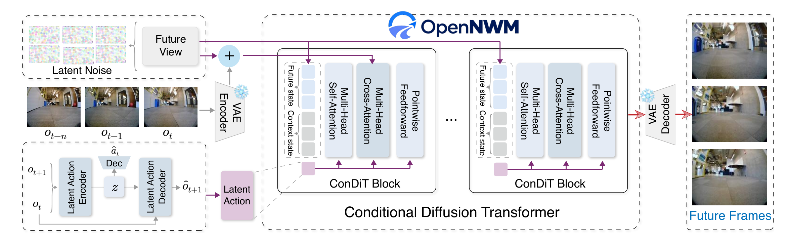

<div align="center">

<h1>OpenNWM</h1>
<h3>A Generalist Navigation World Model<br>with Latent Action Pretraining</h3>

<p><strong>OpenSpace Lab</strong></p>
<p><em>Learn navigation dynamics from action-free video. Adapt them to physical actions.</em></p>

<p>
  <a href="https://openspace-lab.github.io/OpenNWM/">🌐 Project Page</a> &nbsp;·&nbsp;
  <a href="https://openspace-lab.github.io/OpenNWM/assets/paper/OpenNWM.pdf">📄 Paper</a> &nbsp;·&nbsp;
  <a href="https://huggingface.co/LittleB0sS/OpenNWM">🤗 Models</a> &nbsp;·&nbsp;
  <a href="https://huggingface.co/datasets/LittleB0sS/NavAnywhere">🤗 NavAnywhere</a>
</p>
<p>
  
  
  
  
</p>



<p><a href="#news">News</a> · <a href="#environment-setup">Setup</a> · <a href="#data-preparation">Data</a> · <a href="#pretrained-models">Models</a> · <a href="#evaluation">Evaluation</a> · <a href="#training">Training</a> · <a href="#roadmap">Roadmap</a></p>
</div>

OpenNWM learns a shared **32-dimensional latent action space** from navigation videos, pretrains a world model on **NavAnywhere**, and adapts it to physical waypoint actions for visual prediction and planning. NavAnywhere brings together **17.5 million observations from 15 sources**, spanning humans, ground robots, and drones.

The pipeline has three parts: **learn latent actions → pretrain navigation dynamics → adapt to physical actions**. This repository provides the models, data recipes, training, prediction, and evaluation tools.

## News

- **2026-10-17** — OpenNWM checkpoints and NavAnywhere are available on Hugging Face, alongside their ModelScope releases.
- **2026-10-16** — Released the Nav15 Pixel+Action LAM and both world model checkpoints, with portable configurations and SHA-256 checksums.

## Environment Setup

Use Linux, Conda, Git, `tar`, `zstd` (`unzstd`), and an NVIDIA GPU with a driver compatible with CUDA 12.4. LAM and NWM use separate environments because their dependencies differ. Run all commands from the repository root unless stated otherwise.

```bash
git clone https://github.com/OpenSpace-Lab/OpenNWM.git
cd OpenNWM

conda create -n open-lam python=3.10 -y
conda create -n open-nwm python=3.10 -y
for runtime in open-lam open-nwm; do
  conda run -n "$runtime" python -m pip install torch==2.6.0 torchvision==0.21.0 \
    --index-url https://download.pytorch.org/whl/cu124
done
conda run -n open-lam python -m pip install -r lam/requirements.txt
conda run -n open-nwm python -m pip install -r nwm/requirements.txt
```

Choose two absolute paths on a disk with enough space: one for extracted data and one for downloads, checkpoints, caches, and outputs.

```bash
conda run -n open-nwm python setup_paths.py \
  --data-root /data/navigation --work-root /data/opennwm --nav-profile 15 \
  --lam-python "$(conda run -n open-lam python -c 'import sys; print(sys.executable)')" \
  --nwm-python "$(conda run -n open-nwm python -c 'import sys; print(sys.executable)')"
source .env
```

This writes a local, Git-ignored `.env` and unpacks the fixed NavAnywhere train/validation recipes. Run `source .env` in every new terminal. By default, setup holds out 5% of the labeled training trajectories for validation and preserves the test sets. To reuse an existing split, pass `--split-root /absolute/path/to/splits`; historical score reproduction requires the original splits and recipes. See [.env.example](.env.example) for all paths.

## Data Preparation

**Download:** [Hugging Face](https://huggingface.co/datasets/LittleB0sS/NavAnywhere) · [ModelScope](https://modelscope.cn/datasets/LittleBoss/NavAnywhere). The full archive collection is approximately **1.93 TB compressed**; allow additional space for extracted frames and training caches.

```bash
"$NWM_PYTHON" - <<'PY'
import os
from huggingface_hub import snapshot_download
snapshot_download(
    "LittleB0sS/NavAnywhere", repo_type="dataset",
    local_dir=os.path.join(os.environ["OPENNWM_WORK_ROOT"], "downloads/NavAnywhere"),
)
PY

# Extract independent NavAnywhere packs and concatenated labeled-data shards.
mkdir -p "$NWM_DATA_ROOT"
(
  cd "$OPENNWM_WORK_ROOT/downloads/NavAnywhere"
  find NavAnywhere -path '*/packs/*.tar.zst' -print0 \
    | xargs -0 -I{} tar --use-compress-program=unzstd -xf '{}' -C "$NWM_DATA_ROOT"
  for first in LAM-Data-{recon,scand,sacson}-*.tar.zst.part-00000; do
    archive=${first%.part-00000}
    cat "${archive}.part-"* | tar --use-compress-program=unzstd -xf - -C "$NWM_DATA_ROOT"
  done
)
```

Expected layout:

```text
$NWM_DATA_ROOT/
├── NavAnywhere/<source>/<trajectory>/{0.jpg, 1.jpg, ...}
├── recon/<trajectory>/{0.jpg, 1.jpg, ..., traj_data.pkl}
├── sacson/<trajectory>/{0.jpg, 1.jpg, ..., traj_data.pkl}  # HuRoN
├── scand/<trajectory>/{0.jpg, 1.jpg, ..., traj_data.pkl}
└── tartan/<trajectory>/{0.jpg, 1.jpg, ..., traj_data.pkl} # TartanDrive, separate
```

**TartanDrive is a separate download**, required for four-dataset world model post-training and the default LAM out-of-domain evaluation. Prepare it using the [original NWM data instructions](https://github.com/facebookresearch/nwm). Its data directory is `tartan`; its split directory is `tartan_drive`. Additional evaluation sets such as GO Stanford also follow the upstream format.

Labeled trajectories store frame-aligned `position` and `yaw` in `traj_data.pkl`. Split lists live at `$NWM_SPLIT_ROOT/<dataset>/{train,val,test}/traj_names.txt`. NavAnywhere requires only numbered RGB frames. Existing data can be reused by updating `.env`; see [DATA.md](DATA.md) for mirror downloads and additional assets.

## Pretrained Models

**Download:** [Hugging Face](https://huggingface.co/LittleB0sS/OpenNWM) · [ModelScope](https://modelscope.cn/models/LittleBoss/OpenNWM). The three original checkpoints total approximately **14.79 GB**.

| Checkpoint | Training | Use |
| :--- | :--- | :--- |
| `lam-nav15-pixel-action-step60k.ckpt` | Pixel+Action LAM, 60K steps | Infer latent actions from image pairs; prepare pretraining caches. |
| `opennwm-nav15-stage1-pretrain60k.pth.tar` | Latent-action pretraining, 60K steps | Initialize world model post-training. |
| **`opennwm-nav15-stage2-joint100k.pth.tar`** | 3K adapter warmup + 100K joint steps | **Physical-action prediction and planning.** |

```bash
"$NWM_PYTHON" - <<'PY'
import os
from huggingface_hub import snapshot_download
snapshot_download(
    "LittleB0sS/OpenNWM",
    local_dir=os.path.join(os.environ["OPENNWM_WORK_ROOT"], "models/OpenNWM"),
)
PY
(cd "$OPENNWM_WORK_ROOT/models/OpenNWM" && sha256sum -c SHA256SUMS)
```

The release includes portable Stage 1/2 configs and a checksum manifest. The world model uses **CDiT-B/2**, four **224 × 224** context frames, and a frozen [SD-VAE](https://huggingface.co/stabilityai/sd-vae-ft-ema), downloaded automatically on first use. Set `NWM_VAE_PATH` to a local VAE directory for offline use. LAM uses **240 × 320** images after a 4:3 center crop.

Use **Stage 2** for physical waypoint actions `(Δx, Δy, Δyaw)`; Stage 1 expects latent actions. These Nav15 checkpoints differ from the older 100K-step LAM / 200K-step NWM ablation weights described in [DATA.md](DATA.md). Generate caches with the LAM checkpoint used by your chosen experiment.

## Evaluation

Start with the released Stage 2 model after preparing the test data. Import it once into a new run directory using its portable config, which replaces historical machine-specific paths:

```bash
"$NWM_PYTHON" run.py nwm import-checkpoint \
  --checkpoint "$OPENNWM_WORK_ROOT/models/OpenNWM/opennwm-nav15-stage2-joint100k.pth.tar" \
  --config "$OPENNWM_WORK_ROOT/models/OpenNWM/configs/opennwm-nav15-stage2.yaml" \
  --run-dir "$OPENNWM_WORK_ROOT/runs/released-stage2"
```

### Visual prediction

Generate ground truth and predictions, then compute **LPIPS, DreamSim, and FID** on RECON, SCAND, and HuRoN:

```bash
"$NWM_PYTHON" run.py nwm infer \
  exp_dir="$OPENNWM_WORK_ROOT/runs/released-stage2" ckp=latest \
  eval_type=time gt=1 output_dir="$OPENNWM_WORK_ROOT/eval/stage2"
"$NWM_PYTHON" run.py nwm infer \
  exp_dir="$OPENNWM_WORK_ROOT/runs/released-stage2" ckp=latest \
  eval_type=time prediction_dir="$OPENNWM_WORK_ROOT/eval/stage2/pred"
"$NWM_PYTHON" run.py nwm eval \
  gt_dir="$OPENNWM_WORK_ROOT/eval/stage2/gt" \
  exp_dir="$OPENNWM_WORK_ROOT/eval/stage2/pred" \
  'datasets_to_eval=[recon,scand,sacson]' eval_types=time
```

For autoregressive rollouts, replace `eval_type=time` with `eval_type=rollout` in both inference commands and use `eval_types=rollout` for metrics. Default rollout rates are 1 and 4 FPS. The released inference protocol uses EMA weights and 250 DDPM steps.

### Navigation planning and LAM

```bash
# Offline navigation planning evaluation; defaults to RECON and SCAND.
"$NWM_PYTHON" run.py nwm plan \
  exp_dir="$OPENNWM_WORK_ROOT/runs/released-stage2" ckp=latest \
  output_dir="$OPENNWM_WORK_ROOT/eval/planning"

# LAM reconstruction and action evaluation, including TartanDrive OOD tests.
"$LAM_PYTHON" run.py lam eval all \
  --checkpoint "$OPENNWM_WORK_ROOT/models/OpenNWM/lam-nav15-pixel-action-step60k.ckpt" \
  --output-dir "$OPENNWM_WORK_ROOT/eval/lam-nav15"
```

Evaluation resumes completed samples/batches when rerun with the same inputs. Use a new output directory when changing checkpoints or protocols. Perceptual metrics download their pretrained networks on first use; prepare their caches before offline evaluation. Detailed options: [NWM](nwm/README.md) · [LAM](lam/README.md).

## Training

The main Nav15 recipe uses **8 GPUs**, with global batches of **160 image pairs for LAM** and **384 observations for NWM** (four prediction targets per observation). The commands below set the main schedule and learning rates explicitly. Smaller GPU counts/batches support experimentation but change the training recipe; matching historical results also requires the original data splits, seeds, and runtime.

### 1. Train the latent action model

The released LAM is the **60K-step checkpoint of a 100K-step cosine schedule**. Preserve that schedule while stopping at 60K:

```bash
cat > "$OPENNWM_WORK_ROOT/lam-nav15.yaml" <<'YAML'
model:
  init_args:
    scheduler_total_steps: 100000
trainer:
  max_steps: 60000
YAML

"$LAM_PYTHON" run.py lam train --variant 4 --profile navanywhere15 \
  --run-dir "$OPENNWM_WORK_ROOT/runs/lam-nav15" \
  --devices 8 --batch-size 20 --precision bf16-mixed \
  --lr 2.5e-5 --warmup-steps 12800 \
  --config "$OPENNWM_WORK_ROOT/lam-nav15.yaml"
```

Use `checkpoints/step=60000.ckpt` for the next step. To skip LAM training, use the released `lam-nav15-pixel-action-step60k.ckpt`. Other variants are `1` (Action), `2` (Pixel), and `3` (DINO); variant `3` additionally requires the teacher assets in the [LAM guide](lam/README.md).

### 2. Prepare training caches

Cache VAE posteriors for the training frames and LAM posterior means for NavAnywhere train/validation pairs. Validation images are encoded online. Choose the LAM checkpoint **before** generating caches; use fresh cache directories when changing it.

<details>
<summary><strong>Cache commands</strong> — run once before world model training</summary>

```bash
# Or point this to your own runs/lam-nav15/checkpoints/step=60000.ckpt.
export LAM_PIXEL_ACTION_CHECKPOINT="$OPENNWM_WORK_ROOT/models/OpenNWM/lam-nav15-pixel-action-step60k.ckpt"

"$NWM_PYTHON" run.py nwm cache-vae --data-root "$NWM_NAVANYWHERE_ROOT" \
  --recipe "$NWM_NAVANYWHERE_RECIPE" \
  --output-root "$NWM_NAVANYWHERE_VAE_LATENT_ROOT" --vae-model "$NWM_VAE_PATH"
"$NWM_PYTHON" run.py nwm cache-vae --data-root "$NWM_DATA_ROOT" \
  --split-root "$NWM_SPLIT_ROOT" \
  --output-root "$NWM_FINETUNE_VAE_LATENT_ROOT" --vae-model "$NWM_VAE_PATH"

# LAM extraction uses the LAM environment.
"$LAM_PYTHON" nwm/prepare.py lam --data-root "$NWM_NAVANYWHERE_ROOT" \
  --recipe "$NWM_NAVANYWHERE_RECIPE" --output-root "$NWM_LATENT_PROXY_ROOT" \
  --checkpoint "$LAM_PIXEL_ACTION_CHECKPOINT"
"$LAM_PYTHON" nwm/prepare.py lam --data-root "$NWM_NAVANYWHERE_ROOT" \
  --recipe "$NWM_NAVANYWHERE_VAL_RECIPE" --output-root "$NWM_NAVANYWHERE_VAL_PROXY_ROOT" \
  --checkpoint "$LAM_PIXEL_ACTION_CHECKPOINT"
```

Interrupted cache jobs skip completed trajectories when rerun. Keep the same checkpoint and recipe for each cache directory. The `latent_reset` post-training path below uses real actions and does not require labeled-data LAM caches.

</details>

### 3. Pretrain and adapt the world model

```bash
# Stage 1: latent-action pretraining on NavAnywhere.
"$NWM_PYTHON" run.py nwm train --mode latentpt --gpus 8 \
  --run-dir "$OPENNWM_WORK_ROOT/runs/stage1" \
  max_train_steps=60000 training.batch_size=48 training.optimizer.lr=2e-4

# Stage 2: real-action adapter warmup, followed by joint post-training.
"$NWM_PYTHON" run.py nwm train --mode latent_reset --gpus 8 \
  --run-dir "$OPENNWM_WORK_ROOT/runs/stage2" \
  finetune.stage1_checkpoint="$OPENNWM_WORK_ROOT/runs/stage1/checkpoints/latest.pth.tar" \
  training.batch_size=48 finetune.warmup_steps=3000 \
  finetune.joint_steps=100000 finetune.adapter_lr=1e-4 finetune.backbone_lr=1e-4
```

To start directly from the released Stage 1 model, replace `finetune.stage1_checkpoint` with `$OPENNWM_WORK_ROOT/models/OpenNWM/opennwm-nav15-stage1-pretrain60k.pth.tar`. Evaluate your trained Stage 2 model with the commands above, using `exp_dir="$OPENNWM_WORK_ROOT/runs/stage2"`.

### Resume and monitor

For LAM, rerun the same training command with `--resume`. For NWM:

```bash
"$NWM_PYTHON" run.py nwm train \
  --resume "$OPENNWM_WORK_ROOT/runs/stage2" --gpus 8
```

Training saves `latest` for continuation, `best` by validation performance, periodic checkpoints, metrics, and visual previews. NWM also retains the stage-transition checkpoint. Exact continuation requires unchanged data, configuration, batch size, and GPU count. The released portable configs are intended for inference; use a training run's complete state and configuration for resumption.

For baseline training, stage variants, and additional options, see [NWM](nwm/README.md) and [LAM](lam/README.md). Implementation parity and smoke-test coverage are recorded in [Validation](tests/VALIDATION.md).

## Roadmap

- [x] Release OpenNWM source code and model configurations.
- [x] Release NavAnywhere data and fixed sampling recipes.
- [x] Release pretrained LAM, Stage 1, and Stage 2 checkpoints.
- [x] Provide training, checkpoint resumption, prediction, and evaluation pipelines.
- [x] Publish the paper, project website, and visual demonstrations.
- [x] Document environment setup, data preparation, and reproduction workflows.
- [ ] Deploy OpenNWM on a **Unitree quadruped** for **closed-loop inference and navigation**. See the [Go2 deployment plan](GO2_DEPLOYMENT.md).

## Acknowledgements & Licenses

OpenNWM is developed by **OpenSpace Lab**. We thank the authors of Meta NWM, CompACT, DreamDojo, and the contributing datasets. Code provenance is recorded against DreamDojo `8f3eeb7`, CompACT `8367a5e`, and Meta NWM `3f6cd8e`.

NWM-derived components retain [CC BY-NC 4.0](licenses/NWM-CC-BY-NC-4.0.txt); DreamDojo LAM components retain [Apache 2.0](licenses/DreamDojo-Apache-2.0.txt). Datasets and external models retain their respective licenses.
